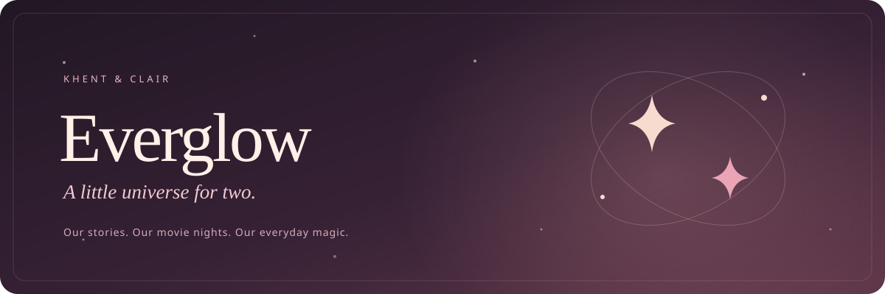

# Everglow

[)](https://github.com/khentmoba/Everglow/releases/latest)
[](https://github.com/khentmoba/Everglow/actions/workflows/deploy.yml)
[](https://everglow-1c6db.web.app)

A private digital relationship scrapbook built with React, TypeScript & Vite for **Khent** and **Clair**.

Everglow tracks your relationship journey through gamified experiences, shared activities, daily engagement, and an AI companion — all wrapped in a warm, animated interface.

## Live Site

**[everglow-1c6db.web.app](https://everglow-1c6db.web.app)**

## Latest Release

> **v6.4.0** — The Cozy Together Update: a faster app on phone and tablet, a Netflix-style player, member accounts with chat and watch parties, and gentler pages across Everglow
> [View full changelog →](https://github.com/khentmoba/Everglow/blob/main/CHANGELOG.md) · [Release page →](https://github.com/khentmoba/Everglow/releases/tag/v6.4.0)

**v6.4.0 — The Cozy Together Update:**

1. **A Faster, Calmer Everglow** — Media pages open without a loading flash, the Dashboard stops idle redraws, and the whole app was rebuilt in React for phone and tablet.
2. **Movie Nights, Our Way** — Netflix-style seek preview, our own player shell with a server picker, caption language that survives a server switch, and cleaner streams.
3. **Anime, Manga & Books** — All eleven anime streams in one picker, a kinder Celestia reader, and a calm Books shelf with download history and listen-along text.
4. **Us, Together** — Approved member accounts, a global chat, a watch-party hub, shared Dashboard shelves, and Clair's welcome gift back on first visit.
5. **Little Joys** — Warmer headers, handwritten labels, a greeting by name and time of day, unread-letter badges, Jukebox live status, and a monthly spend bar.

_Previous releases: [v6.3.0](https://github.com/khentmoba/Everglow/releases/tag/v6.3.0) · [v6.2.0](https://github.com/khentmoba/Everglow/releases/tag/v6.2.0) · [v6.1.0](https://github.com/khentmoba/Everglow/releases/tag/v6.1.0) · [v6.0.0](https://github.com/khentmoba/Everglow/releases/tag/v6.0.0) · [v5.3.0](https://github.com/khentmoba/Everglow/releases/tag/v5.3.0) · [v5.2.0](https://github.com/khentmoba/Everglow/releases/tag/v5.2.0) · [v5.1.0](https://github.com/khentmoba/Everglow/releases/tag/v5.1.0) · [v5.0.0](https://github.com/khentmoba/Everglow/releases/tag/v5.0.0) · [All releases →](https://github.com/khentmoba/Everglow/releases)_

---

## Features

### Core

| Feature | Description | Version |
|---------|-------------|---------|
| **Gateway** | Animated passcode entry door (passcodes are configured via env, never hardcoded) | 1.0.0 / 3.0.0 |
| **Dashboard** | Main hub with anniversary counter, XP, preview cards, and all feature tiles | 1.0.0 / 6.0.0 |
| **Heartbeat** | Daily mood tracking with partner status indicators | 1.0.0 |
| **Guardian** | Animated cat mascot with random messages and mood prompts | 1.0.0 |
| **Sanctuary** | Private real-time couple's chat | 1.0.0 |
| **Daily Bloom** | Virtual garden with 5 plant types, seasonal bonuses, shared garden view, and weather overlay | 1.0.0 / **6.0.0** |
| **Date Randomizer** | 1000+ date ideas — shake to discover | 1.0.0 |
| **XP System** | Gamified levels, streaks, and sound effects | 1.1.0 |

### Relationship

| Feature | Description | Version |
|---------|-------------|---------|
| **Bucket List** | Shared couple bucket list with 6 categories, status tracking, and Firestore persistence | **6.0.0** |
| **Calendar** | Shared couple calendar with date nights, anniversaries, reminders, and recurring events | **6.0.0** |
| **Gallery** | Shared photo gallery with upload, captions, tags, and full-screen viewer | **6.0.0** |
| **Starlight Jar** | Drop gratitude notes and memories into a virtual jar | 1.1.0 / 6.0.0 |
| **Relationship Timeline** | Visual timeline of relationship milestones on the dashboard | **6.0.0** |
| **Upcoming Countdowns** | Countdown timers to next special day on the dashboard | **6.0.0** |
| **Journal** | Shared journal with locked/private entries and tags | **6.1.0** |
| **Creator Studio** | Custom love letters with wax seal styling, surprises, and memory moments | **6.2.0** |

### Entertainment

| Feature | Description | Version |
|---------|-------------|---------|
| **Cinema** | Shared movie/anime watchlist powered by TMDB with Netflix modal drawer, Top 10 rankings, resume progress, and offline downloads | 1.0.0 / **6.3.0** |
| **Anime** | Dedicated anime hub with in-house HLS player, episode selector, AniSkip reveals, hero trailers, and buffer-free streams | 5.0.0 / **6.3.0** |
| **Manga** | Full manga library with MangaCelestia reader overhaul, continue reading shelf, and hot updates | 3.4.0 / 6.2.0 |
| **Books** | Book discovery (Open Library), in-app reader, and shared couple book list | 3.2.0 / **6.3.0** |
| **Jukebox** | Live music status from Last.fm for both partners | 1.1.0 |
| **Academy** | Trivia game with 8 categories, solo study, and 1v1 challenges | 1.1.0 |
| **Canvas** | Collaborative drawing with real-time Firestore sync | 1.1.0 |

### Play Zone

| Feature | Description | Version |
|---------|-------------|---------|
| **Play Zone Hub** | Games hub with Table Tennis World Tour, Fun Race 3D, and Masked Special Forces | 1.2.0 / 4.0.0 |
| **Table Tennis** | WebGL table tennis with solo and 1v1 multiplayer via Firestore | 3.3.0 |

### AI & Social

| Feature | Description | Version |
|---------|-------------|---------|
| **Motchi AI** | AI assistant with Safari voice input, Agnes Flash power, vision, and 50+ callable tools | 5.0.0 / **6.2.0** |
| **Watch Party** | Named rooms, live episode/caption sync, server-anchored playback on the Everglow stream, and WebRTC voice chat | **6.3.0** |
| **Push Notifications** | FCM-powered notifications with topic subscriptions and in-app toasts | **6.0.0** |

### UI / UX

| Feature | Description | Version |
|---------|-------------|---------|
| **Dusk Petal Theme** | Romantic dark palette with Cormorant Garamond + Outfit typography | 3.0.0 |
| **Cinematic Cinema** | Floating pill nav, hero carousel, shimmer skeletons, medal badges, gradient overlays, glass-feel reviews | 3.0.0 |
| **Hover-to-Play Trailers** | Desktop poster hover scales + plays looping YouTube trailer | 3.1.0 |
| **Live Presence** | 15s heartbeat + online/doodle freshness windows | 3.1.0 |
| **Multi-Provider Video** | VidFast, VixSrc, Videasy, VidSrc with sandbox iframe | 1.5.3 / 5.3.0 |

---

## Tech Stack

| Layer | Technology |
|-------|------------|
| **Framework** | React 19 + TypeScript, built with Vite |
| **Routing** | React Router 7 |
| **State** | Small services with `subscribe()`, read through React hooks (no state library) |
| **Backend** | Firebase (Auth, Firestore, Storage, Hosting, Cloud Functions, FCM) |
| **Real-Time** | Firestore listeners (chat, canvas, presence, watchlist, multiplayer) |
| **External APIs** | TMDB, Open Library, OpenTDB, Last.fm, Jikan, AniList, MangaDex, Comick, MangaKakalot, Mangasee123, Bato, Spotify, always through Cloud Functions |
| **AI** | Agnes 3.0 Flash via SSE streaming with 50+ function-calling tools |
| **Notifications** | Firebase Cloud Messaging (FCM) with topic subscriptions |

---

## Project Structure

```
react/
  src/
    main.tsx                         # Entry: agent mode, service worker, renders App
    App.tsx                          # Every route, wired to a feature page
    core/
      agent/                         # Agent mode: ?agent= jumps, floating HUD, demo fixtures
      services/                      # Firebase, auth, presence, notifications
      system/                        # Logger, prefs, viewport, app updates
      theme/                         # Dusk Petal tokens: colors, typography, motion, paint
      utils/liveSource.ts            # Live Firestore data with timeouts and retries
    features/<name>/                 # One folder per feature: pages, components, services
    shared/widgets/                  # Everglow design system (cards, headers, buttons, states)
    shared/widgets/shelf/            # Poster shelves shared by Cinema, Anime, and Books
  tools/*.test.mjs                   # Headless Chrome tests: shell, offline worker, players
  vite.config.ts                     # Build + generated service worker (dist/sw.js)
assets/                              # Fonts and images, served as-is
web/                                 # Icons, manifest, and embed helpers copied into the build
functions/                           # Cloud Functions: proxies, Motchi AI, schedules, triggers
tool/                                # CI guards (tool/ci/run_checks.mjs) and the agent smoke test
firestore.rules                      # Who can read and write what
```

## Getting Started

### Prerequisites

- Node.js 22+
- Firebase CLI (`npm install -g firebase-tools`) for deploys
- Chrome, for the browser tests

### Setup

```bash
git clone https://github.com/khentmoba/Everglow.git
cd Everglow
npm --prefix react ci
npm --prefix react run dev        # http://localhost:5173/?agent=1 for demo data
```

### Checks

```bash
npm --prefix react run typecheck
npm --prefix react run build
npm --prefix react test
node tool/ci/run_checks.mjs
node tool/agent_smoke.mjs react/dist
```

## Deployment

Every push to `main` deploys to **[everglow-1c6db.web.app](https://everglow-1c6db.web.app)** through `.github/workflows/deploy.yml`:

1. Typechecks and builds the React app (`react/dist`, with its service worker)
2. Verifies Cloud Functions (`npm run verify` in `functions/`)
3. Deploys Cloud Functions, Firestore rules, and Storage rules
4. Deploys Firebase Hosting, then checks the site is live

> **Note:** The workflow expects a repository secret named `FIREBASE_SERVICE_ACCOUNT_EVERGLOW_1C6DB` containing a Firebase service account JSON key with the **Firebase Hosting Admin** role.

## Cloud Functions

| Function | Purpose |
|----------|---------|
| `proxyCatalog` | Keyless catalog proxy (Open Library, Jikan) with login-token guard |
| `proxyBookText` | CORS proxy for Open Library plain text fetching |
| `cleanupGallery` / `deleteGalleryPhoto` | Gallery storage cleanup + photo deletes |
| `proxyMangaImage` | CORS proxy for MangaDex at-home image servers |
| `proxyMangaKakalotImage` | CORS proxy for MangaKakalot chapter pages |
| `proxyMangaKatana` | CORS proxy for MangaKatana chapter pages |
| `proxyMangaDex` | CORS proxy for MangaDex catalog API |
| `proxyComick` | CORS proxy for Comick catalog API |
| `proxyAnimeImage` | CORS proxy for anime CDN thumbnails (Crunchyroll, Funimation) |
| `proxyLastfmImage` | CORS proxy for Last.fm album artwork (dashboard leaderboards) |
| `proxyGalleryImage` | CORS proxy for gallery + Firebase Storage images |
| `proxyScanlation` / `proxyFetchHtml` | CORS proxies for scanlation sites and HTML fetching |
| `proxyWatchStream` | Authenticated stream proxy with public-host and redirect checks |
| `proxyTmdb` | Authenticated TMDB proxy (server-side API key, ID-token required) |
| `proxyLastfm` | Authenticated Last.fm proxy (server-side API key) |
| `proxySpotifySearch` / `spotifyExchange` / `spotifyRefresh` / `spotifyCurrentlyPlaying` | Spotify OAuth + search + playback |
| `proxyAI` / `proxyAIv2` | Motchi AI proxy — Agnes 3.0 Flash (apihub.agnes-ai.com) via SSE streaming, 512K context, 50+ tools |
| `verifyPasscode` | Server-verified passcode login (Khent/Clair) |
| `health` | Public liveness + Firestore reachability |
| `onNewChatMessage` + 5 triggers | Firestore triggers: push + Discord fan-out for chat, moods, stars, watchlist, gallery, milestones |
| `motchiDailyDigest` + 7 schedules | Motchi scheduled jobs: digests, recaps, nudges, reminders, memory sweep |
| `notifyDiscordWatch` / `discordInteractions` | Discord watch-party notifications + interactions |
| `sweepStalePresence` / `motchiStats` | Presence janitor + Motchi usage stats |

## Release History

The full release-by-release history lives in [`CHANGELOG.md`](./CHANGELOG.md) and the [releases page](https://github.com/khentmoba/Everglow/releases):

- [**v6.4.0**](https://github.com/khentmoba/Everglow/releases/tag/v6.4.0) — The Cozy Together Update: Faster app on phone and tablet, Netflix-style player, member accounts with chat and watch parties, gentler pages across Everglow
- [**v6.3.0**](https://github.com/khentmoba/Everglow/releases/tag/v6.3.0) — The Speed & Serenity Update: Sub-second loading without fake caches, in-house HLS anime player, Cinema offline downloads, Books overhaul, text copying, mobile polish
- [**v6.2.0**](https://github.com/khentmoba/Everglow/releases/tag/v6.2.0) — The Together & Wonder Update: Watch Together & Netflix Cinema, MangaCelestia, Anime overhauls, Motchi voice input, Creator Studio, phone polish
- [**v6.1.0**](https://github.com/khentmoba/Everglow/releases/tag/v6.1.0) — The Glow-Up Update: Journal, 50+ Motchi tools, Cinema polish, XP rewards, phone performance
- [**v6.0.0**](https://github.com/khentmoba/Everglow/releases/tag/v6.0.0) — The Relationship Hub Update: Bucket List, Calendar, Gallery, Daily Bloom Overhaul, Push Notifications, AI Function Calling
- [**v5.3.0**](https://github.com/khentmoba/Everglow/releases/tag/v5.3.0) — Anime Embeds: provider switching, VidSrc, AniList fix
- [**v5.2.0**](https://github.com/khentmoba/Everglow/releases/tag/v5.2.0) — Rich Anime Details: AniList/Jikan, anime search modal
- [**v5.1.0**](https://github.com/khentmoba/Everglow/releases/tag/v5.1.0) — Anime Browse tab, MangaDex proxy, Play Zone HUD refactor
- [**v5.0.0**](https://github.com/khentmoba/Everglow/releases/tag/v5.0.0) — Anime Arrives: dedicated screen, image proxy, dashboard preview
- [**v4.0.0**](https://github.com/khentmoba/Everglow/releases/tag/v4.0.0) — Play Zone Polish: boot gestures, manga reader consolidation
- [**v3.4.0**](https://github.com/khentmoba/Everglow/releases/tag/v3.4.0) — Manga Reader, Masked Special Forces, cloud proxy
- [**v3.3.0**](https://github.com/khentmoba/Everglow/releases/tag/v3.3.0) — Play Zone Games (Table Tennis, Fun Race 3D), watchlist consolidation
- [**v3.2.0**](https://github.com/khentmoba/Everglow/releases/tag/v3.2.0) — Our Books (Open Library, in-app reader), instant trailers
- [**v3.1.0**](https://github.com/khentmoba/Everglow/releases/tag/v3.1.0) — Live Presence, hover-to-play trailers, Our Cinema glass UI
- [**v3.0.0**](https://github.com/khentmoba/Everglow/releases/tag/v3.0.0) — Cinematic Cinema overhaul, Piano Tiles rewrite, Breyan access
- [**v2.1.0**](https://github.com/khentmoba/Everglow/releases/tag/v2.1.0) — Play Zone Overhaul: HexGL Drift, Melody Tiles song selection
- [**v2.0.0**](https://github.com/khentmoba/Everglow/releases/tag/v2.0.0) — Melody Tiles, mobile optimization, bloat cleanup
- [**v1.5.3**](https://github.com/khentmoba/Everglow/releases/tag/v1.5.3) — Cinema real iframe fix, provider cleanup, popup-ad sandbox
- [**v1.5.2**](https://github.com/khentmoba/Everglow/releases/tag/v1.5.2) — Philippines Trending: real streaming rankings
- [**v1.5.1**](https://github.com/khentmoba/Everglow/releases/tag/v1.5.1) — Sandbox bypass hardening + cinema and UI polish
- [**v1.5.0**](https://github.com/khentmoba/Everglow/releases/tag/v1.5.0) — Cinema overhaul: genres, cast and reviews, carousel, rankings
- [**v1.4.0**](https://github.com/khentmoba/Everglow/releases/tag/v1.4.0) — Cinema multi-provider video player + episode drawer
- [**v1.3.0**](https://github.com/khentmoba/Everglow/releases/tag/v1.3.0) — Racing auto-respawn + touch UI
- [**v1.2.0**](https://github.com/khentmoba/Everglow/releases/tag/v1.2.0) — Midnight Drive racing game
- **v1.0.0** — First private builds (untagged)

See [all releases](https://github.com/khentmoba/Everglow/releases) for the full changelog.

## License

Private — for Khent and Clair only.
